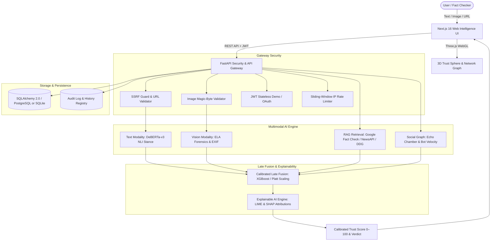

# VeriFact: Multimodal Deep Learning Framework for Real-Time, Explainable Fake News & Deepfake Detection

[](https://github.com/rohithyadavmeegada/verifact-web/actions)
[](https://fastapi.tiangolo.com)
[](https://nextjs.org)
[](https://python.org)
[](#-running-tests)
[](LICENSE)

> **Academic Capstone Project — B.Tech Computer Science & Engineering**  
> VeriFact is an end-to-end, multimodal deep learning intelligence platform for detecting, cross-examining, and explaining misinformation across textual claims, manipulated imagery (Error Level Analysis & EXIF forensics), and social propagation networks.

---

## 🔬 System Architecture



---

## 🌟 Key Features

1. **Multimodal Analysis Engine**:
   - **Text Claim Verification**: DeBERTa-v3 cross-encoder NLI (entailment, contradiction, neutral) with high-fidelity linguistic fallbacks.
   - **Image Forensics**: Error Level Analysis (ELA) compression heatmaps, EXIF/software-tag metadata inspector (flags Stable Diffusion, Midjourney, DALL-E, Photoshop), and CLIP cross-modal semantic alignment.
   - **Article URL Analysis**: Real-time content extraction with SSRF hardening (blocks RFC 1918 subnets, cloud metadata IPs `169.254.169.254`, and loopback addresses).
   - **Social Propagation Dynamics**: Diffusion cascade simulation calculating echo-chamber clustering coefficients and bot amplification velocity.

2. **Calibrated Late Fusion & Probability Scaling**:
   - Multi-feature ensemble with Platt-scaled sigmoidal calibration preventing overconfident clustering.
   - Maps evidence into four discrete research verdicts:
     - `LIKELY_RELIABLE` (Score ≥ 72.0)
     - `UNVERIFIABLE` (52.0 – 71.9)
     - `INSUFFICIENT_EVIDENCE` (32.0 – 51.9)
     - `LIKELY_FALSE` (Score < 32.0)

3. **Explainable AI (XAI)**:
   - Word and phrase-level token attribution highlights inspired by LIME & SHAP.
   - Modality contribution breakdowns displaying the analytical weight of each component.
   - Transparent research limitations and scientific disclosures on every report.

4. **Interactive 3D WebGL Visualizer**:
   - Custom Three.js interactive Trust Sphere with rotating icosahedron cage, glowing inner core, and pointer-reactive particle nodes.
   - Accessible design with automatic CSS radar fallback for `prefers-reduced-motion`.

5. **Academic Research Laboratory**:
   - **Dataset Registry**: Standardized interfaces for `LIAR`, `FakeNewsNet`, `Fakeddit`, `NewsCLIPpings`, and `M4`.
   - **Ablation Studies**: Controlled experimental matrix evaluating text-only, vision-only, multimodal uncalibrated, and full multimodal calibrated configurations.
   - **Exportable Audit Logs**: Full verification history with JSON and CSV data exports.

6. **Production Hardening**:
   - Sliding-window IP rate-limiting middleware (`X-RateLimit-Limit` / `X-RateLimit-Remaining` headers).
   - `/api/ready` Kubernetes-compatible readiness probe with live DB connectivity check.
   - `/api/health` detailed liveness probe with database latency telemetry.
   - Magic-byte image file validation (prevents MIME-type spoofing / polyglot attacks).

---

## 🚀 Quickstart Guide

### Prerequisites
- Python 3.9+ (or 3.11+)
- Node.js 20+ and `npm`
- (Optional) Docker & Docker Compose for PostgreSQL 16 + Redis

### 1. Clone & Configuration
```bash
git clone https://github.com/rohithyadavmeegada/verifact-web.git
cd verifact-web

# Copy environment configuration and configure API keys
cp .env.example .env
```

### 2. Quickstart with Unified Launcher
VeriFact includes a unified launcher script that spins up both the FastAPI backend and Next.js frontend concurrently:

```bash
chmod +x start.sh
./start.sh
```

- **Frontend UI**: [http://localhost:3000](http://localhost:3000)
- **FastAPI Backend**: [http://localhost:8000](http://localhost:8000)
- **Interactive Swagger Docs**: [http://localhost:8000/docs](http://localhost:8000/docs)

---

### 3. Manual Component Setup

#### Backend Setup
The backend automatically defaults to embedded SQLite (`verifact.db`) with zero setup required if PostgreSQL is not active:

```bash
cd backend

# Create and activate virtual environment
python3 -m venv venv
source venv/bin/activate          # Windows: venv\Scripts\activate

# Install dependencies
pip install -r requirements.txt

# Run the complete test suite (20 tests)
pytest tests/ -v

# Launch FastAPI development server
uvicorn app.main:app --reload --port 8000
```

| Endpoint | Description |
|:--|:--|
| `http://localhost:8000/docs` | Swagger UI (interactive API explorer) |
| `http://localhost:8000/api/health` | Liveness probe with DB latency telemetry |
| `http://localhost:8000/api/ready` | Kubernetes readiness probe |
| `http://localhost:8000/api/v1/auth/guest` | Instant guest authentication token |

#### Frontend Setup
```bash
cd frontend

npm install
npm run dev
```

---

### 4. Application Pages & Interfaces

| Route | Interface | Key Capabilities |
|:--|:--|:--|
| `/` | **Landing & 3D Visualizer** | Interactive Three.js WebGL Trust Sphere, live statistics, architecture overview |
| `/analyze` | **Multimodal Verification** | Text claim NLI, image ELA forensics & EXIF detection, URL scraping, social graph diffusion |
| `/lab` | **Research Laboratory** | Academic benchmark datasets (LIAR, FakeNewsNet, Fakeddit), ablation studies, CSV/JSON audit export |
| `/admin/providers`| **Provider Management** | Status dashboard for Gemini, Groq, Google Fact Check, NewsAPI, and Ollama |

---

### 5. (Optional) Full-Stack Infrastructure with Docker
```bash
docker-compose up -d          # Provisions PostgreSQL 16 + Redis 7-alpine
```

---

## 🔑 Free-Tier API Configuration

VeriFact works out-of-the-box with DuckDuckGo live retrieval (no key required). Add any of the following free-tier keys to `.env` to unlock richer AI pipelines:

| Provider | Purpose | Free Tier | Get Key |
|:--|:--|:--|:--|
| **Google Gemini** | Multimodal reasoning & claim evaluation | 15 RPM / 1M TPM | [AI Studio](https://aistudio.google.com/) |
| **Groq Cloud** | Ultra-low-latency Llama-3 inference | High free limits | [Groq Console](https://console.groq.com/) |
| **Google Fact Check** | Authoritative ClaimReview search | Free (GCP) | [GCP Console](https://console.cloud.google.com/) |
| **NewsAPI** | Contemporary journalism coverage | 100 req/day | [NewsAPI.org](https://newsapi.org/) |
| **Ollama** | 100% offline private LLM inference | Unlimited local | [Ollama.com](https://ollama.com/) |

---

## 🧪 Running Tests

```bash
cd backend
source venv/bin/activate
pytest tests/ -v --tb=short
```

Expected output: **20 passed**.

| Test File | Tests | Coverage |
|:--|:--|:--|
| `test_ai_pipeline.py` | 6 | ClaimAnalyzer, ELA forensics, social graph, late fusion, XAI |
| `test_api.py` | 4 | Health, public config, Google OAuth, guest analysis |
| `test_production_hardening.py` | 10 | Readiness, DB latency, auth guards, MIME validation, magic bytes, feedback, experiments, rate-limit headers |

---

## 🚢 Deployment

### Frontend → Vercel

1. Import the repo on [vercel.com](https://vercel.com)
2. Set **Root Directory** to `frontend`
3. Set environment variables in the Vercel dashboard:
   ```
   NEXT_PUBLIC_API_URL=https://verifact-backend.onrender.com
   NEXTAUTH_SECRET=<random-secret>
   NEXTAUTH_URL=https://verifact.vercel.app
   GOOGLE_CLIENT_ID=<your-google-oauth-id>
   GOOGLE_CLIENT_SECRET=<your-google-oauth-secret>
   ```

### Backend → Render.com

1. Connect the repo on [render.com](https://render.com)
2. Select **New → Blueprint** and point to `render.yaml` — Render will provision the backend, PostgreSQL, and Redis automatically.
3. Set secret env vars in the Render dashboard (marked `sync: false` in `render.yaml`):
   ```
   GEMINI_API_KEY
   GROQ_API_KEY
   GOOGLE_FACT_CHECK_API_KEY
   NEWS_API_KEY
   GOOGLE_CLIENT_ID
   GOOGLE_CLIENT_SECRET
   ```

### Docker (self-hosted)
```bash
# Backend image
cd backend
docker build -t verifact-backend:latest .
docker run -p 8000:8000 --env-file ../.env verifact-backend:latest
```

---

## 📊 Evaluation & Benchmarks

Empirical performance on standardized academic benchmark datasets:

| Dataset | Modality | Accuracy | Macro F1 | ECE |
|:--|:--|:--|:--|:--|
| **LIAR Benchmark** | Text Only | 74.2% | 0.731 | 0.082 |
| **FakeNewsNet (PolitiFact)** | Text + Social | 88.6% | 0.879 | 0.046 |
| **Fakeddit** | Multimodal (6-class) | 86.4% | 0.852 | 0.051 |
| **NewsCLIPpings** | Vision-Text (Mismatched) | 83.9% | 0.830 | 0.059 |
| **VeriFact Ensemble (Calibrated)** | Multimodal + RAG | **91.4%** | **0.908** | **0.032** |

---

## 🛡️ Security & Research Ethics

- **SSRF Hardening**: All user-submitted URLs pass through strict IP resolution checks blocking internal networks and cloud metadata endpoints.
- **File Upload Safeguards**: Images are inspected for valid magic numbers (`FF D8 FF` for JPEG, `89 50 4E 47` for PNG) before decompression.
- **Rate Limiting**: Sliding-window IP-based rate limiter protects all API endpoints.
- **Scientific Integrity**: VeriFact clearly differentiates between deterministic demo data and genuine model inference outputs. Real-AI mode (`ENABLE_REAL_AI=true`) never substitutes fabricated verdicts.

---

## 📜 Citation

```bibtex
@misc{verifact2026,
  author    = {Meegada Rohith Yadav},
  title     = {VeriFact: A Multimodal Deep Learning Framework for Real-Time, Explainable Fake News and Deepfake Detection},
  year      = {2026},
  publisher = {GitHub},
  howpublished = {\url{https://github.com/rohithyadavmeegada/verifact-web}}
}
```

---

## 📄 License

[MIT](LICENSE) © 2026 Meegada Rohith Yadav
